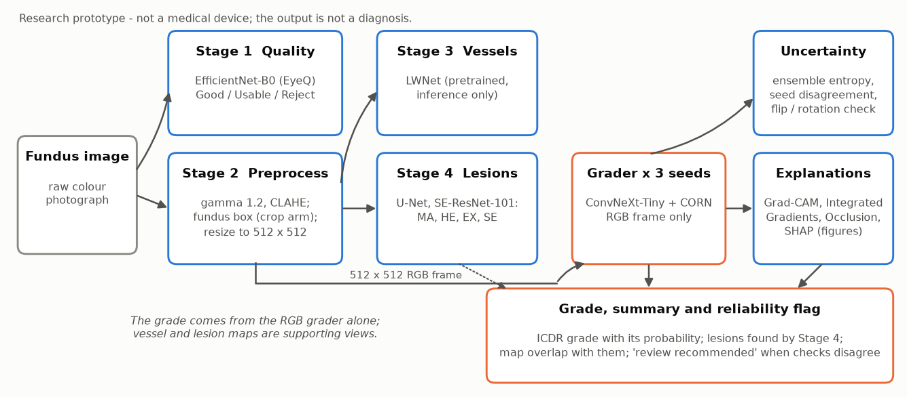
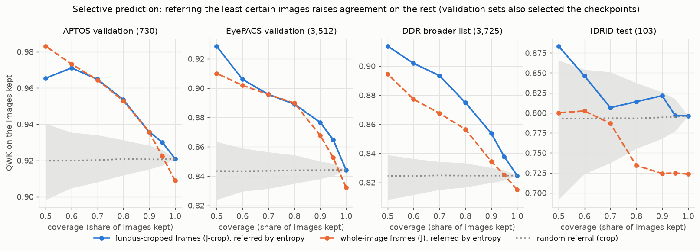
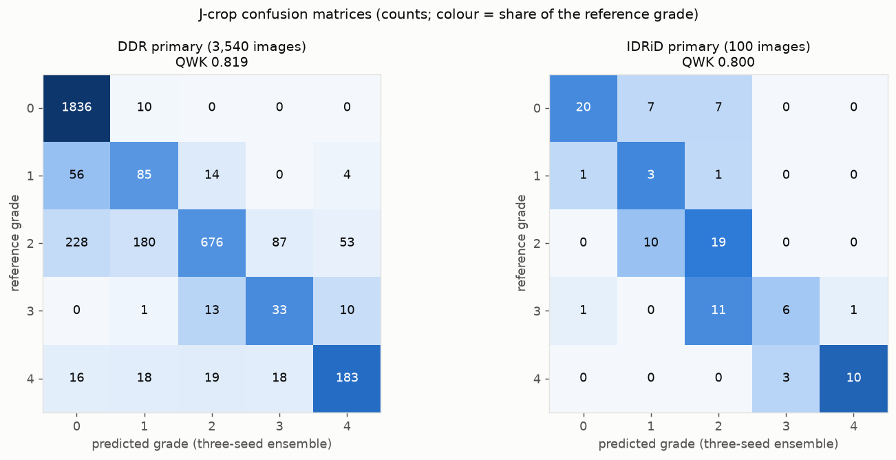
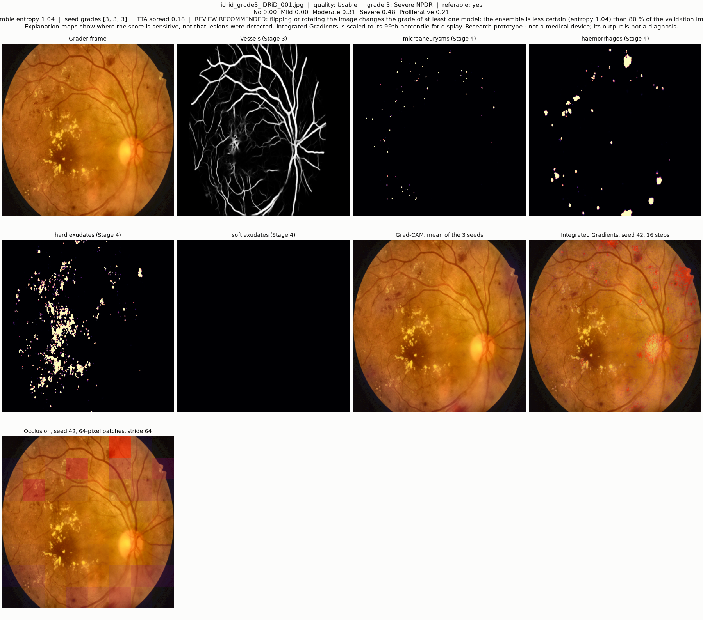
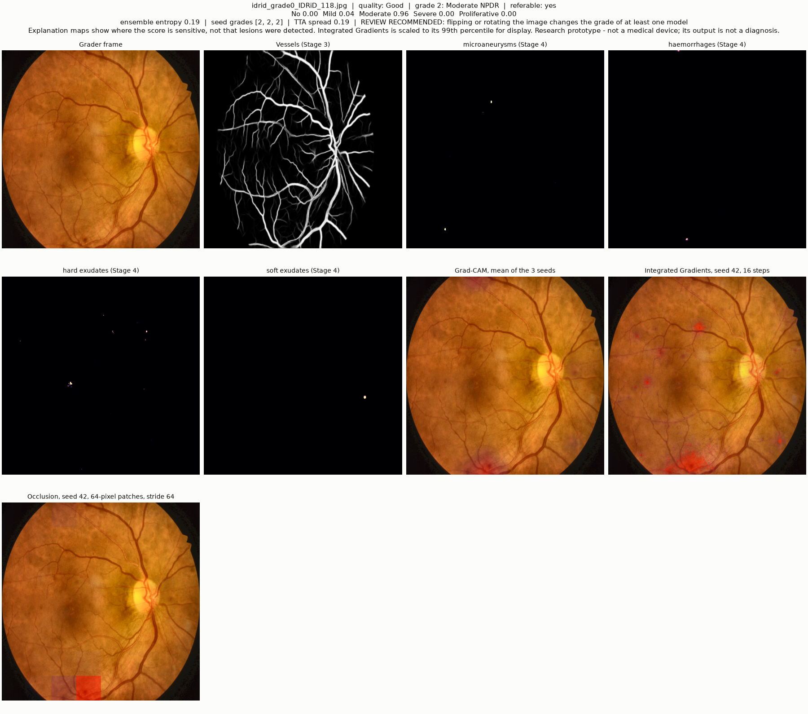
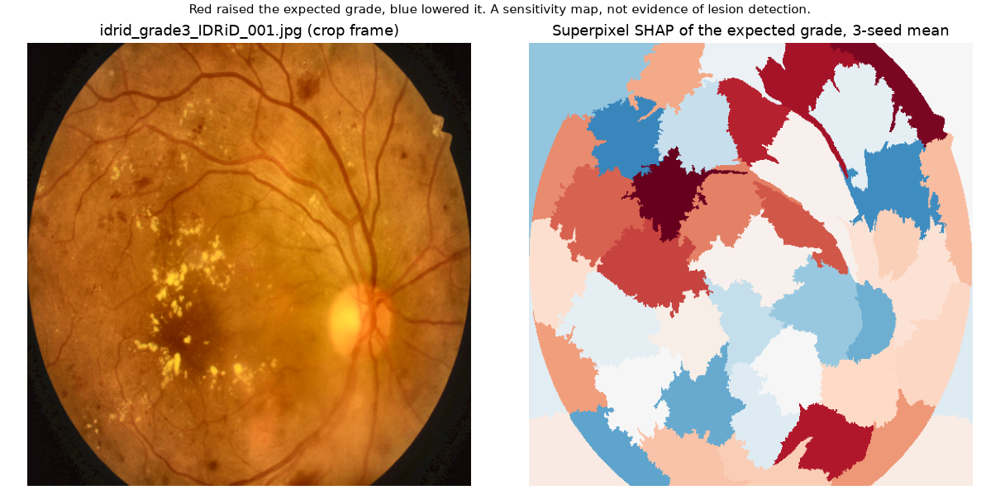

# Quality-Aware Explainable Framework for Diabetic Retinopathy Detection

Repository `dr-grading`: a diabetic retinopathy grading pipeline.

Grades diabetic retinopathy (DR) from a colour fundus photograph on the five-level ICDR scale (no DR, mild, moderate,
severe non-proliferative, proliferative), checks the image quality, segments vessels and lesions, estimates how certain
the grade is, and explains it. This repository holds the inference, evaluation and training code, a local web demo with
a Docker image, and the evaluation lists and per-image predictions that reproduce every reported number.

> **Research prototype. Not a medical device. Its output is not a diagnosis** and must not be used for any decision
> about a patient.



| Stage | What it does | Model |
|---|---|---|
| 1 Quality | Good / Usable / Reject | EfficientNet-B0 trained on EyeQ |
| 2 Preprocessing | gamma 1.2, CLAHE, fundus box, 512 x 512 frame | no model |
| 3 Vessels | vessel probability map (supporting view) | LWNet, pretrained by its authors, inference only |
| 4 Lesions | microaneurysm, haemorrhage, hard and soft exudate maps (supporting view) | U-Net with SE-ResNet-101 encoder |
| Grader | ICDR grade from the RGB frame alone | ConvNeXt-Tiny + CORN head, three seeds |
| Uncertainty | ensemble entropy, seed disagreement, flip / rotation stability, selective prediction | from the three seeds |
| Explanations | Grad-CAM, Integrated Gradients, Occlusion; superpixel SHAP for figures | |

The grader has two variants that differ only in the frames: **J-crop** cuts every image to its fundus box before the
resize (the final model) and **J** resizes the whole image. Both were trained jointly on APTOS 2019 and EyePACS.

## Results

Quadratic weighted kappa (QWK), mean of three seeds; paired grade-stratified bootstrap, 2,000 resamples, 95 % intervals.
Full tables: [`results/tables/TABLES.md`](results/tables/TABLES.md), method: [`docs/METHOD.md`](docs/METHOD.md).

| QWK | DDR primary (3,540 images) | IDRiD primary (100 images) |
|---|---|---|
| P: APTOS only, ImageNet start | 0.509 | 0.642 |
| P-EP: APTOS, EyePACS-adapted start | 0.593 | 0.738 |
| J: joint, whole-image frames | 0.800 | 0.703 |
| **J-crop: joint, fundus-cropped frames (final model, chosen after the external evaluation)** | **0.811** | **0.788** |
| J-crop - P | +0.301 (+0.281 to +0.323) | +0.146 (+0.078 to +0.223) |
| J - P | +0.290 (+0.270 to +0.311) | +0.062 (-0.004 to +0.129) |
| J-crop - P-EP | +0.218 (+0.199 to +0.236) | +0.050 (-0.005 to +0.109) |
| J-crop - J | +0.011 (+0.003 to +0.019); 2 of 3 seeds positive | +0.084 (+0.037 to +0.141) |

Development sets, J-crop, mean of three seeds: APTOS validation 0.916, EyePACS validation 0.827 (these also selected
the checkpoints). Three-seed ensemble QWK of J-crop: DDR primary 0.819, IDRiD primary 0.800.

On IDRiD the advantage of J-crop over the EyePACS-adapted baseline P-EP is not shown (the interval includes zero),
and J (whole-image frames) is not better than P-EP there (-0.035, interval -0.103 to +0.031).





**How to read these numbers.**

- **The final model was chosen after the external evaluation.** J-crop was preferred to J once its DDR and IDRiD results
  were known, so those results are **not an unbiased estimate** for a model selected in advance. The development sets
  (APTOS and EyePACS validation) also selected the checkpoints.
- **DDR and IDRiD were used before.** Both test sets were used in earlier experiments, and those results were known when
  joint training was chosen; no hyperparameter, threshold or checkpoint was tuned on them.
- **DDR has no patient identifiers**, and its file-name family is tied to the grade (grades 0 and 4 each occur in one
  family only), so source and grade are confounded.
- **The IDRiD primary set has 100 images**; its intervals are wide.
- The baselines P and P-EP were trained on APTOS only, with batch size 2 against 16 for the joint models, so a joint
  model minus P confounds the extra data with the batch size.
- No clinical-utility, equivalence or non-inferiority claim is made.

## Install

Python 3.11 is the version the code was developed and tested with (locally and in the Docker image); the GPU smoke test
also ran on a Colab runtime with a newer Python.

```bash
python -m venv .venv && . .venv/bin/activate          # Windows: .venv\Scripts\activate
pip install -r requirements.txt                        # on Linux CPU: see the note at the top of the file
python scripts/download_weights.py                     # model files into weights/ (Zenodo record; see WEIGHTS_TERMS.md)
```

`config.yaml` is the only file to edit: dataset roots, weights and output folders, device. A `config.local.yaml` beside
it is read instead when present, and every script takes `--config`.

## Grade one image

```bash
python -m drgrade.pipeline data/demo_images/idrid_grade3_IDRiD_001.jpg --explain grad_cam
```

This prints the grade with the written summary and writes a JSON and a figure per image to `outputs/pipeline/`. On a
four-core CPU one image with Grad-CAM takes a few minutes; Integrated Gradients and Occlusion add several each.

Example output for two of the demo images (IDRiD training set; the second shows a disagreement with the reference
grade 0: the pipeline gives grade 2 and flags the result for review because a flip or rotation changes a seed's grade).
Integrated Gradients overlays are scaled to the 99th percentile of the map for display only; no attribution and no
localisation number changes:





Superpixel SHAP of the expected grade for the first image (`scripts/run_explanations.py shap`, three-seed mean, figures
only). The superpixels over its exudates are small and of mixed sign, and the largest positive values lie over the
upper vessel arcade: the map shows where the score is sensitive, not where lesions are.



```python
from drgrade.config import load_config
from drgrade.pipeline import Pipeline
result, views = Pipeline(load_config()).run("image.jpg", explanations=("grad_cam",))
print(result["grade"], result["summary"]["lines"][0])
```

## Web demo and Docker

```bash
python app/server.py                                   # http://localhost:8501
```

```bash
docker build -f app/Dockerfile -t drgrade:1.0.0 .
docker run --rm -p 8501:8501 --memory 5g -v "$(pwd)/weights:/weights:ro" drgrade:1.0.0
```

The page shows the stages one after another, ending with a written summary and reliability statement. Uploaded images
are deleted when the run ends. Details, environment variables and a Hugging Face Space recipe: [`docs/DOCKER.md`](docs/DOCKER.md).

The reliability statement is a wording aid, **not a validated method**. It says "review recommended" when Stage 1 rates
the image Reject, the three seeds disagree, a flip or rotation changes a seed's grade, or the ensemble entropy is above
the threshold of the 20 % least certain validation images, and it quotes how often the grade was right on validation
images in the same certainty band. Those validation sets also selected the checkpoints, so the quoted rates are
optimistic, and images from other cameras or clinics can be less reliable than they suggest.

## Reproduce every number

The per-image predictions of the released models on the evaluation sets are in `results/predictions/` and
`results/validation/`; the baselines' are in `data/baselines/`. Everything below runs on a CPU without the weights
unless noted.

| Command | Output | Reproduces |
|---|---|---|
| `python scripts/evaluate_external.py ddr --predictions results/predictions/ddr` | `outputs/external/ddr/result_*.json` | DDR primary (3,540) and broader (3,725): QWK per model and seed, contrasts with intervals |
| `python scripts/evaluate_external.py idrid --predictions results/predictions/idrid` | `outputs/external/idrid/result_*.json` | IDRiD primary (100) and all 103 |
| `python scripts/make_tables.py` | `results/tables/*.csv`, `results/tables/TABLES.md`, `results/external/` | every table above and the development-set table |
| `python scripts/run_uncertainty.py` | `results/uncertainty/` | ensemble QWK, seed disagreement, error detection, selective prediction |
| `python scripts/make_reliability_calibration.py` | `data/reliability_calibration.json` | validation rates behind the demo's reliability wording |
| `python scripts/make_figures.py` | `figures/` | pipeline diagram, selective-prediction curves, confusion matrices |
| `python scripts/evaluate_external.py ddr --predict` (weights, DDR images, GPU advised) | `outputs/external/ddr/predictions/` | the per-image predictions themselves, from the raw images |
| `python scripts/run_explanations.py localisation` (weights, DDR lesion-segmentation images) | `outputs/explanations/` | the localisation table |
| `python scripts/parity_check.py --images data/demo_images --reference data/parity/idrid_demo_reference.npz` (weights) | PASS / FAIL table | that this installation reproduces the reference grader logits, grades and quality on the ten demo images |
| `python scripts/make_tables.py --check` | PASS / FAIL | that the committed tables equal a fresh computation |

Predictions regenerated on another platform differ from the released tables in the last digits (float16 inference on
the original GPU; logits agree to about 1e-5 across CPU builds), and decoded grades can change for an image whose
cumulative probability sits at 0.5.

## Retrain

[`docs/TRAINING.md`](docs/TRAINING.md): `prepare_frames.py`, `train_quality.py`, `train_lesions.py`, `train_grader.py`
(one run per seed and frame variant), all resumable. Retraining is **not bit-exact** (GPU nondeterminism).
`scripts/smoke_gpu.py` runs every trainer for a few hundred steps on small subsets as a check on a GPU machine.

Two facts about the Stage-1 and Stage-4 numbers:

- **Stage 4's best checkpoint was selected on TJDR's official test split, used as the validation set** (together with
  10 IDRiD validation images). The Stage-4 numbers it reports are selection-set numbers, not a held-out evaluation.
- Stage 1 was trained with batch size 32; its accuracy on the EyeQ test split is reported by
  `python scripts/train_quality.py --eval-only weights/quality_efficientnet_b0_eyeq.keras`.

## Limitations

- Research prototype; not a medical device; not a diagnosis; not validated for clinical use or screening.
- J-crop was chosen after the external evaluation; its DDR and IDRiD results are not an unbiased estimate (above).
- The models were trained on APTOS 2019 and EyePACS photographs, with Stage 4 on IDRiD and TJDR. Performance on other
  cameras, populations, image qualities or other grading conventions is unknown and can be lower; agreement with the
  reference is already lower on the external sets (QWK 0.82 and 0.80 for the ensemble) than on the APTOS validation
  set (0.92).
- DDR has no patient identifiers and source and grade are confounded; the IDRiD primary set has 100 images.
- The explanation maps show where the expected grade is sensitive. **Overlap of a map with lesion masks is not
  evidence that the model detects lesions** (the localisation check reports it against a chance level).
- Stage 3 runs a vessel model trained on DRIVE on preprocessed images that differ from its training data; the vessel
  and lesion maps are supporting views and do not feed the grade.
- Uncertainty comes from three seeds of one architecture (no dropout in the model), not from a calibrated probabilistic
  model; the reliability wording is not a validated method.
- Weights are for research use under the dataset terms ([`WEIGHTS_TERMS.md`](WEIGHTS_TERMS.md)).

## Authors and acknowledgements

N. S. Yasodharan, Adithya Babu, N. Ramasami and L. K. Rohit, Department of Information Technology, PSG College of
Technology, Coimbatore, India (ORCID iDs in [`CITATION.cff`](CITATION.cff)).

The authors thank Mrs. K. P. Thamilselvi, Assistant Professor (Sr. Gr.), Department of Information Technology, PSG
College of Technology, for her guidance during this project. They also thank the providers of the APTOS 2019, EyePACS,
EyeQ, IDRiD, TJDR and DDR datasets and of the LW-Net vessel-segmentation model, and acknowledge the GPU resources of
Google Colaboratory used for training.

During the preparation of this work the authors used Claude (Anthropic) to assist with writing and editing the text and
with writing analysis and figure-generation code. After using this tool, the authors reviewed and edited the content as
needed and take full responsibility for the content.

## Citation

Cite the software with [`CITATION.cff`](CITATION.cff) (GitHub's "Cite this repository" button) and the trained weights
with their archive, [doi:10.5281/zenodo.23393863](https://doi.org/10.5281/zenodo.23393863). The study this software was
built for, *Training-data diversity, not pathology priors, drives external generalisation of deep diabetic retinopathy
grading: a controlled multi-seed study*, has been submitted to *Biomedical Signal Processing and Control* and is not yet
published, so it has no citation yet. References of the methods and datasets are in
[`docs/REFERENCES.md`](docs/REFERENCES.md).
Code: Apache-2.0 ([`LICENSE`](LICENSE), third-party notices in [`NOTICE`](NOTICE)); weights:
[`WEIGHTS_TERMS.md`](WEIGHTS_TERMS.md).
